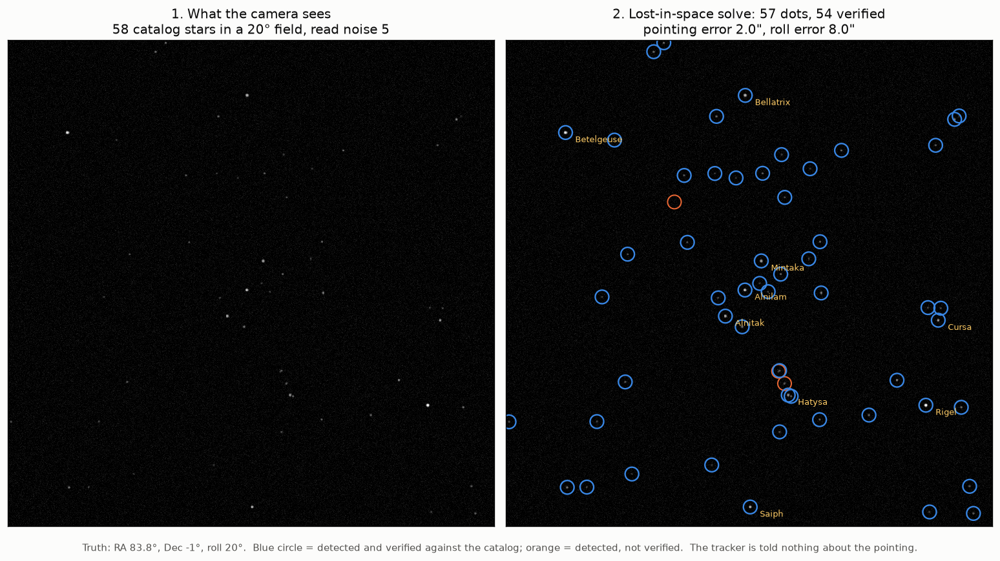
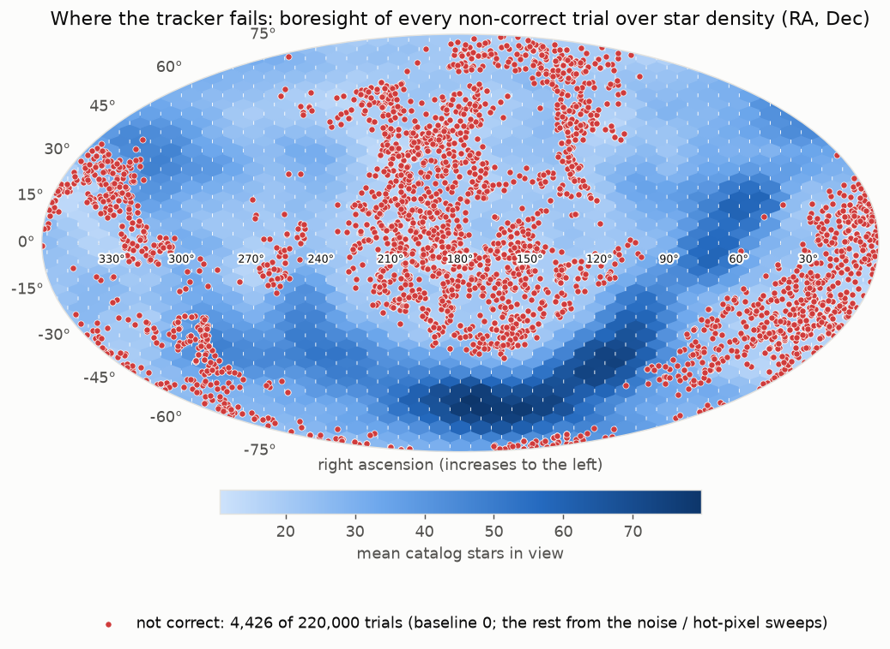
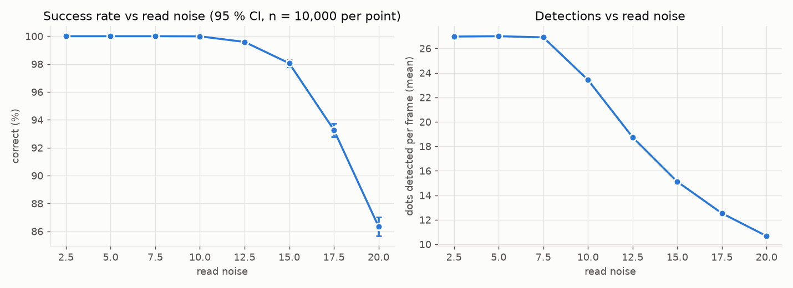
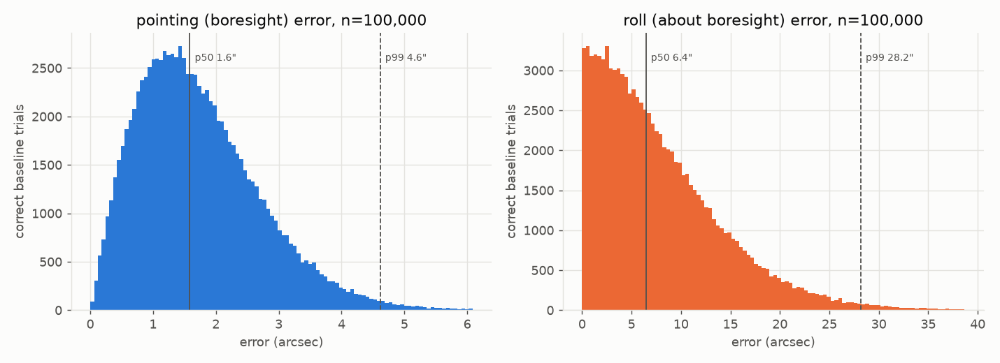
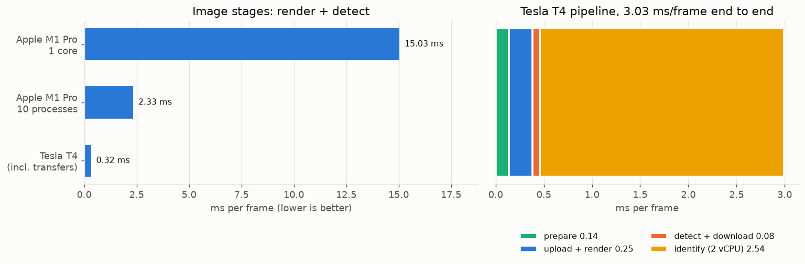

# Lost-in-space star tracker, validated on 220,000 simulated skies with CUDA

A star tracker takes a photo of the stars and works out which way a spacecraft is pointing, with **no prior
guess** ("lost in space"). This project builds one from scratch in Python and validates it with a Monte Carlo campaign
over 220,000 simulated skies. The image-heavy stages run as hand-written CUDA kernels on a GPU.

| | |
|---|---|
| **100,000 / 100,000** random skies solved | ≥ 99.996 % success at 95 % confidence, normal noise |
| **0 wrong answers in 220,000 trials** | < 0.0017 % at 95 %, across every noise and fake-star level; every failure is an honest "no solution" |
| **1.6″ pointing accuracy** (median) | 4.6″ at p99; roll 6.5″ median. One pixel is ~71″ |



## Pipeline

```
attitude ──► render ──► detect ──► identify ───────────────────────► attitude
(truth)      image      centroids   vote on star-pair angles,         + error vs truth
             (GPU)      (GPU)       check, SVD solve, verify (CPU)
```

| stage | what it does | where |
|---|---|---|
| catalog | Yale Bright Star Catalog, 2,847 stars brighter than mag 5.5, as unit vectors | `tracker/catalog.py` |
| camera | 1024×1024 px pinhole, 20° field of view, attitude = rotation sky → camera | `tracker/camera.py` |
| render | Gaussian star blobs (σ = 1.2 px) + background + read noise | `render_cpu.py`, `kernels/render.cu` |
| detect | 5σ threshold, 3×3 local maximum with a tie-break, 5×5 weighted centroid (0.10 px median error) | `detect_cpu.py`, `kernels/detect.cu` |
| identify | 266k catalog pair angles sorted for binary search; every detected pair votes; a consistency check removes misnamed dots | `identify.py` |
| solve | Wahba's problem by SVD, `A = U diag(1, 1, det U det V) Vᵀ` | `solve.py` |
| verify | ≥ 4 dots must land within 25″ of a catalog star, else "no solution" | `identify.py` |

## Why a GPU

On one CPU core, a frame takes ~17 ms, and **render + detect are 87 % of it**: they touch all 1,048,576 pixels, while
identification works on ~27 stars. That per-pixel work is what GPUs are built for:

- `render.cu`: one thread per pixel per frame (block 16×16, grid 64×64×frames); each frame's star list is staged through shared
  memory in chunks of 64. Noise comes from a counter-based hash (seed, frame, pixel → Box-Muller), so the GPU and a NumPy
  reference produce the same image.
- `detect.cu`: a 16×16 tile plus a 2-pixel halo in shared memory; threshold, local maximum and centroid per thread; output
  slots claimed with `atomicAdd`. Overflow raises an error instead of silently dropping stars.
- Images never leave the GPU; only star lists come back. The GPU matches the CPU to **one float32 rounding step**
  (4.9·10⁻⁴ counts), and centroids agree to **3·10⁻⁷ px**.

## Results (Day 5 campaign, `docs/results/day5/`)

220,000 frames on a Tesla T4 in 19 minutes. Every condition shares the same skies (common random numbers), so the sweeps are paired comparisons.

| read noise (counts) | 5 (baseline) | 10 | 12.5 | 15 | 17.5 | 20 |
|---|---|---|---|---|---|---|
| correct, % (n = 10,000 per level) | 100 | 99.99 | 99.59 | 98.06 | 93.28 | 86.35 |

| hot pixels (fake stars) per frame | 0 | 10 | 20 | 40 | 80 |
|---|---|---|---|---|---|
| correct, % | 100 | 99.99 | 99.83 | 98.11 | 80.54 |

Wrong answers in all of these conditions: **0**. 95 % Wilson intervals are in `docs/results/day5/report.txt`.



**The tracker fails where the sky is empty.** At 4× noise, failures are 2.5 % near the Milky Way (39 stars in view on average)
and 29 % near the galactic poles (18 stars). The vote needs enough real stars to beat chance coincidences.

|  |  |
|---|---|

## Benchmark (Day 6, `docs/results/day6/benchmark.md`)



Fair-comparison rules: the CPU code is vectorised NumPy running one process per core on an **Apple M1 Pro (8 performance + 2 efficiency
cores)**, using its fastest noise generator; the GPU is a **Tesla T4 with a 70 W power limit** (Colab); timings use warm-up runs,
synchronise before stopping the clock, include CPU↔GPU transfers, and report medians.

- Image stages (render + detect): **T4 0.32 ms/frame**, against 15 ms on one M1 Pro core (**47×**) and 2.3 ms on all 10 cores (**7.2×**).
- **End to end, the T4 machine is *not* faster than the 10-core Mac** (3.0 vs 2.7 ms/frame). Once the GPU removes the image work,
  identification on Colab's 2 vCPUs is 84 % of the time (Amdahl's law). Pairing the T4 with more CPU cores for identification
  is projected at ~0.75 ms/frame; that was not run as one system.

## Validation

- **131 tests** (`pytest -q`; the 12 GPU tests skip themselves without CUDA, and a clang check syntax-checks the `.cu` files on a Mac).
- Every stage was gated before the next one was built: centroid error < 0.15 px; true-identity attitude of a few arcseconds;
  > 90 % lost-in-space success on 1,000 skies; GPU image = CPU image to float32 tolerance, with the same stars detected.
- The matching tolerance (eps = 25″) was **chosen by a stress test**: wider values looked safer but collapsed under noise
  (60″ → 61 % correct with noise + fake stars, against 90 % at 20–25″).
- The campaign is reproducible: every trial is a pure function of (seed, trial number), runs resume after interruption, and
  the CPU and GPU backends produce identical result rows.

## Limitations

- Synthetic images: Gaussian PSF, flat background, Gaussian read noise. No real-sky test, no stray light, no cosmic rays, no saturation or smear.
- Ideal pinhole camera: no lens distortion or calibration error.
- Catalog positions are J2000 with no proper motion, parallax or aberration (aberration alone is up to ~20″).
- Close double stars (< 25″) can't be told apart; either name gives an attitude within eps.
- The GPU only does render + detect; identification is CPU-side, and is the bottleneck on a 2-vCPU host.

## Reproduce

```bash
conda create -n startracker python=3.12 numpy scipy matplotlib astroquery pytest && conda activate startracker
pytest -q                                            # 131 tests (the 12 GPU ones skip without CUDA)
python -m experiments.demo_figure                    # the picture above
python -m experiments.montecarlo                     # 1,000 CPU trials with per-stage timing
python -m experiments.benchmark --device cpu         # CPU benchmark
python -m experiments.campaign --backend cpu --scale 0.01 && python -m experiments.analyze_campaign
```

GPU (Google Colab, T4): open `notebooks/colab_run.ipynb`; it runs the GPU tests, the full campaign
(`python -m experiments.campaign --backend gpu`, ~20 min) and `experiments.benchmark --device gpu`.

How each part works, with worked examples: [`LEARNING.md`](LEARNING.md). Decisions, measurements and mistakes: [`BUILD_LOG.md`](BUILD_LOG.md).
